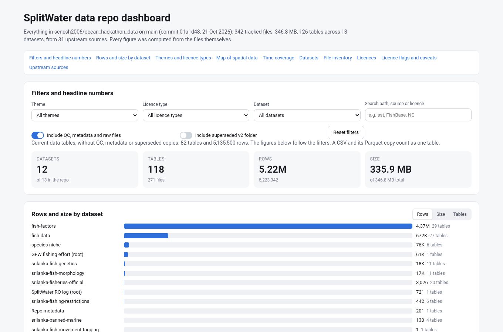

# SplitWater data repo dashboard

An interactive overview of every dataset in this repo: what each one holds, its size, row counts, time coverage, spatial layers, licences and caveats. It's the standalone version of the Cursor Page "SplitWater data repo dashboard".



## Open it

- **Locally:** download `index.html` and double-click it. It's fully self-contained, with React, the styles and the data all inlined. It needs no server, no internet connection and no CDN.
- **In the browser, without downloading:** https://htmlpreview.github.io/?https://github.com/senesh2006/ocean_hackathon_data/blob/main/dashboard/index.html
- **GitHub Pages:** turn on Pages for `main` (Settings → Pages → Deploy from branch → `main` / root). The dashboard will then be at `https://senesh2006.github.io/ocean_hackathon_data/dashboard/`.

If the page ever shows an error box instead of the dashboard, the box names the JavaScript error, so report that text.

## What's on it

- **Filters:** theme, licence type, dataset, a free-text search on path, source or licence, and toggles for QC/metadata/raw files and for the superseded `updated data sets/` folder.
- **Headline numbers:** datasets, tables, rows and size. These follow the filters.
- **Charts:** rows, size or table count by dataset, by theme and by licence type.
- **Map:** restriction zones from `srilanka-fishing-restrictions/zones.geojson`, 800 randomly sampled fish occurrences (seed 7) out of 6,004 clean records, and the Global Fishing Watch effort grid (0.1° summed into 0.2°, log colour scale).
- **Time coverage:** the observation date range of each table.
- **Datasets table and file inventory:** every name links to its folder on GitHub. A CSV and its Parquet twin count as one table, and raw text/JSON/PDF files are grouped per folder.
- **Licence breakdown, licence flags and caveats, and the 31 upstream sources.**

## Snapshot

The numbers come from commit `01a1d48` on `main` (21 Oct 2026, the species-niche push): 342 tracked files, 346.8 MB, 126 tables across 13 datasets, from 31 upstream sources. Current data tables, without QC, metadata or superseded copies, come to 82 tables and 5,135,500 rows. Files added later, including this `dashboard/` folder, are not counted until the dashboard is rebuilt.

## Files

| File | What it is |
|---|---|
| `index.html` | The dashboard: one self-contained file |
| `dashboard_data.json` | All computed numbers and map layers the page uses (inventory rows, lookup lists, simplified SVG map paths) |
| `dashboard_inventory.csv` | The same inventory as a flat table: one row per table or raw-file group |
| `build_dashboard.py` | Scans the repo and rebuilds `dashboard_data.json` and `dashboard_inventory.csv` |
| `build_html.py`, `package.json`, `src/` | Bundle the React source (`src/App.tsx`, the same code as the Page) into `index.html` |
| `screenshot.png` | Preview image |

## Rebuild

```bash
# 1. Recompute the numbers. Needs: pandas, pyarrow, numpy, shapely. Takes about a minute.
python dashboard/build_dashboard.py

# 2. Re-bundle the page. Needs Node 18+.
cd dashboard
npm install
python build_html.py
```

`build_dashboard.py` reads every git-tracked file except `dashboard/`, and does the following:

- Counts rows and columns.
- Finds time coverage from date and year columns.
- Detects lat/lon columns.
- Takes each file's licence and source from `data_library.csv`. Exceptions: `species-niche/` and `srilanka-fishing-restrictions/` are taken from their folder catalogs.
- Takes last-commit dates from `git log`.

## Licence caveats

- The dashboard code (`*.py`, `src/`, `index.html`) is MIT and the computed summaries and docs are CC BY 4.0, following the repo [LICENSE](../LICENSE).
- The underlying data keeps its own licences, which are shown per table on the page.
- **Non-commercial (CC BY-NC or similar):** the Global Fishing Watch effort grid, FishBase and AquaMaps-derived tables (species list, traits, `species-niche/`), and the UNEP-WCMC coral reefs layer, plus the seabed shelf grid derived from it.
- **Mixed by record:** OBIS and GBIF occurrences.
- **No stated licence:** Ministry of Fisheries Bulletin 2025 tables, so treat them as all rights reserved.
- **Unclear copyright:** Sri Lankan gazette and Act text extracts.
- **Share-alike:** OSM and geoBoundaries geometries (ODbL 1.0) and BOLD barcodes (CC BY-SA 4.0).
- **Unknown provenance:** `splitwater_ro_log_1h_5s.csv`.
- The map shows the GFW grid summary and an 800-point occurrence sample, so it carries the same licence conditions as those sources.
- Restriction zone shapes are approximate and are **not legal boundaries**. 12 of the 40 zones have no geometry.
